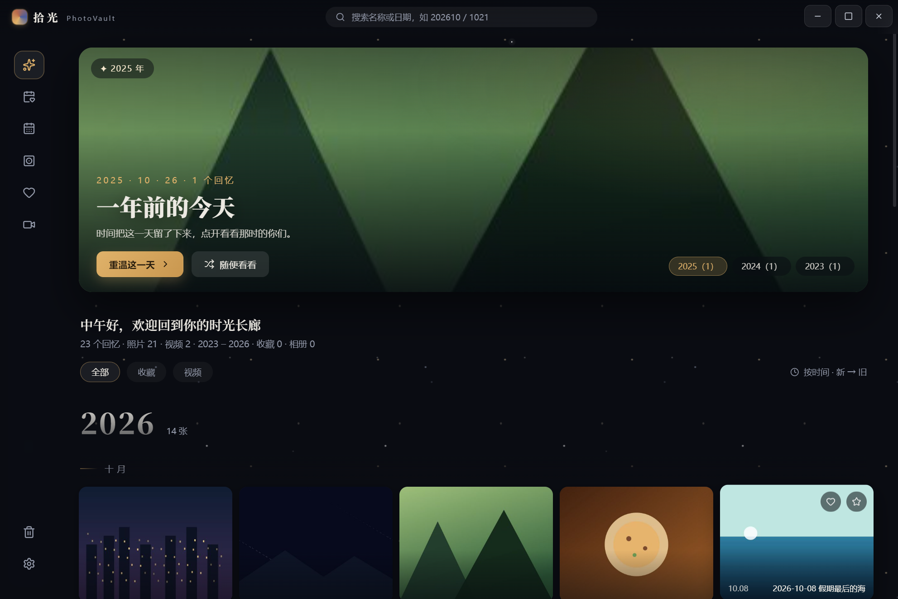
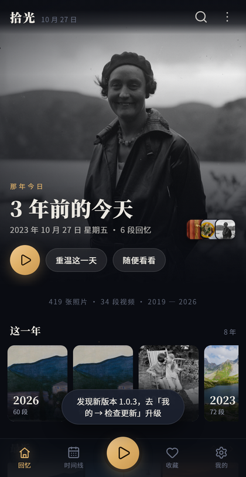
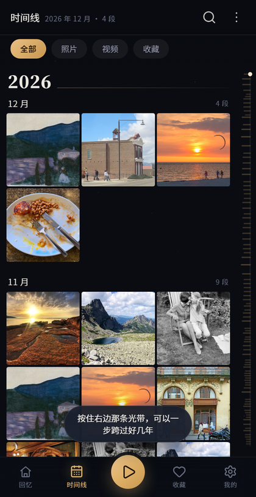
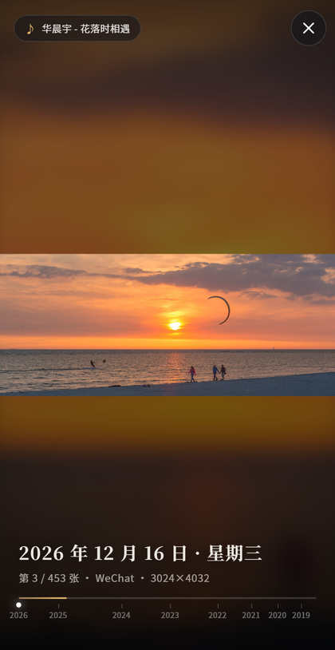
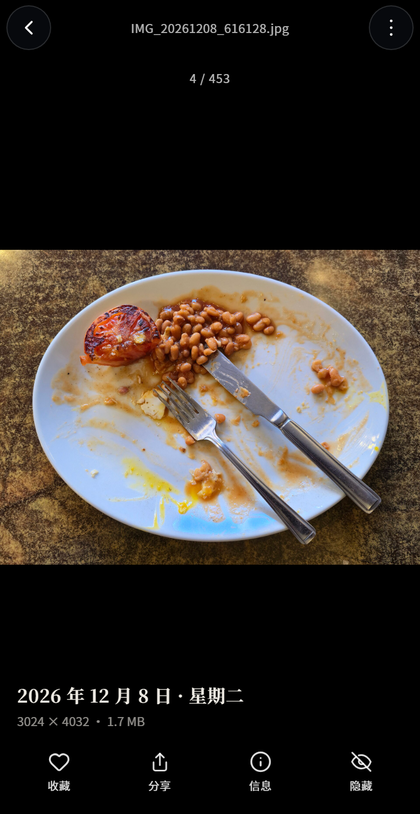
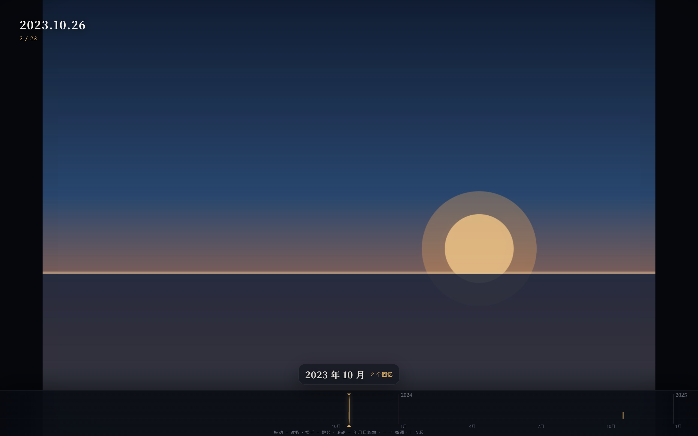
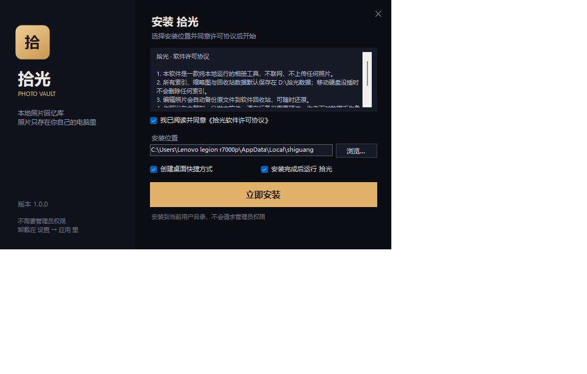

# 拾光 · shiguang

> 把你拍过的光，排成一条可以往回走的长廊。
> **两个版本**：Windows 桌面版 + Android 手机版。照片永远只在你自己的设备里 —— 不注册、不上传、没有云端。

**English**: shiguang ("picking up light") is a local-first photo & video memory app. Two editions: Electron for Windows, and a native Android app. No account, no cloud, no upload — your media never leaves your device.

<p align="center">
  
</p>

## ⬇️ 下载

| 版本 | 安装包 | 大小 | 要求 |
|---|---|---|---|
| 🖥 **电脑版** | [shiguang-setup-1.0.0.exe](https://github.com/gubaocheng0228-wq/shiguang/releases/download/v1.0.0/shiguang-setup-1.0.0.exe) | 186 MB | Windows 10 / 11，免管理员安装 |
| 📱 **手机版** | [shiguang-1.0.2.apk](https://github.com/gubaocheng0228-wq/shiguang/releases/download/v1.0.2/shiguang-1.0.2.apk) | 26 MB | Android 7.0 及以上 |

手机版装过一次之后就能在「我的 → 检查更新」里升级，不用再传安装包。

---

## 📱 手机版（Android）

<p align="center">
  
  
  
  
</p>

### ✨ 功能

- **时间线**：按年月分块、虚拟滚动（几千张也不卡），右侧那条「记忆密度光带」按住上下滑，可以一步跨过好几年
- **那年今日**：打开就是往年今天，配一句「3 年前的今天」
- **全屏放映**：照片一张一张交叉淡入、缓慢推近（Ken Burns），内置《好想我回来啊》《花落时相遇》，底部时间轴跟着镜头走；点一下暂停，下滑退出
- **大图**：左右滑动翻页、双指缩放、双击放大、下滑关闭；视频原画播放，可拖动进度
- **收藏 / 隐藏 / 搜索 / 首次引导**：隐藏只是从拾光里移走，相册文件不动
- **应用内更新**：检查更新 → 下载 → 安装，收藏与设置都保留
- **横竖屏自适应**：3 / 4 / 5 / 6 列自动切换；界面跟随刘海与手势条的安全区

### 和电脑版的差别

| | 电脑版 | 手机版 |
|---|---|---|
| 图库来源 | 你指定的文件夹（如 `D:\IQOO`） | 系统相册（MediaStore） |
| 编辑 | 旋转 / 裁剪 / 亮度对比饱和，写回文件 | 无（手机系统相册自带编辑更顺手） |
| 删除 | 回收站，可还原 | 「隐藏」，只影响拾光里的显示 |
| 放映 | 全屏交叉淡入 + 音乐 | 同左，另加手势与底部时间轴 |
| 更新方式 | 重新下载安装包 | 应用内检查更新 |

### 🧩 技术实现

手机上没有 Node，也塞不进 sharp / ffmpeg，所以是「原生壳 + WebView」：

- **界面层**：`HTML / CSS / JS`，和电脑版同一套视觉语言，跑在 WebView 里（同一个 Chromium 内核，手感与桌面预览一致）
- **原生层（Java）**：
  - `MediaRepo` 读 MediaStore 建索引、按目标尺寸从**原图**降采样生成缩略图并落盘缓存
  - `AssetServer` 在 `127.0.0.1` 起一个只监听本机的迷你 HTTP 服务，把缩略图 / 原图 / 视频（支持 Range，可拖进度）/ 音乐喂给界面
  - `MainActivity` 负责权限、沉浸式全屏、返回键、分享、安全区
  - `UpdateManager` 负责检查更新：清单 RSA 验签 → 下载 → SHA256 校验 → 交给系统安装器
- **为什么不用云**：照片不出设备，没有服务器成本，也没有"哪天服务停了照片就没了"的问题

```
shiguang-mobile/
├── app/src/main/java/com/shiguang/app/
│   ├── MainActivity.java     WebView 壳：JS 桥、权限、沉浸式、返回键、分享
│   ├── MediaRepo.java        相册索引 + 缩略图缓存 + 音乐清单
│   ├── AssetServer.java      本机迷你 HTTP 服务（缩略图 / 原图 / 视频 / 音乐）
│   ├── UpdateManager.java    检查更新、验签、下载、调起安装
│   └── ApkProvider.java      把下载好的 APK 以 content:// 交给系统安装器
├── app/src/main/assets/www/  界面：index.html / base.css / pages.css / app.js / timeline.js …
├── app/src/main/assets/music/ 放映音乐（01.m4a / 02.m4a）
├── scripts/                  出图标、静态自检、发布、验证更新
└── docs/OTA.md               发版与更新说明
```

---

## 🖥 电脑版（Windows）

<p align="center">
  
  
</p>

### ✨ 功能

- **时间线**：按年/月自动归档的瀑布流，底部密度时间轴——拖动读时间、松手跳转、滚轮在 年/月/日 三级间缩放
- **那年今日**：像手机相册一样，把往年今天的故事放在首屏
- **幻灯片放映**：全屏交叉淡入淡出，照片按时间正序轮播，底部时间轴同步跟随
- **放映背景音乐**：把 `.mp3 / .m4a` 放进项目根目录 `music\`，放映时随机循环播放（`M` 开关）
- **大图查看器**：缩放/拖拽、收藏、1-5 星、旋转/裁剪/调色（编辑自动备份原文件、保留拍摄日期）
- **相册**：把任意照片归入相册，随时打开
- **回收站**：删除先进回收站（带缩略图），可恢复或彻底清空；编辑前自动备份
- **搜索**：文件名 + 日期数字（`202610` = 2026 年 10 月）
- **HEIC / HEIF / AVIF / TIFF**：自动转码预览，Windows 缺解码器也能看
- **首次使用引导**：新装用户第一次打开会自动分步介绍所有功能
- **沉浸模式**：静止几秒后界面自动隐去，只留照片

### 📦 安装

两种方式任选（数据都在本地，互不影响）：

1. **安装包**：到 [Releases](https://github.com/gubaocheng0228-wq/shiguang/releases) 下载 `shiguang-setup-1.0.0.exe`，双击安装（不需要管理员权限）
2. **便携版**：下载便携版压缩包解压后，直接运行 `shiguang.exe`

> 视频缩略图与时长探测依赖 **ffmpeg**：安装包与便携版已内置；从源码运行请自行把 `ffmpeg.exe` 放到 `bin\` 目录。

---

## 🛠 从源码运行

### 电脑版

需要 Node.js 18+ 和 npm。

```powershell
npm install          # sharp 会自动拉取预编译二进制
npm start            # 启动
npm test             # 数据层自测（58 项）
npm run smoke        # 界面冒烟（自动打开、自动退出、输出 [SMOKE] 报告）
npm run build        # 打包便携版（输出目录在 scripts/build-portable.js 顶部可改）
```

> 视频功能需要 ffmpeg：从 [gyan.dev](https://www.gyan.dev/ffmpeg/builds/) 或 [BtbN builds](https://github.com/BtbN/FFmpeg-Builds/releases) 下载 Windows 构建，把 `ffmpeg.exe` 放到项目根目录的 `bin\` 下（没有它，图片功能不受影响，只是视频没有缩略图和时长）。

### 手机版

需要 JDK 17+、Android SDK Platform 34、Build-Tools 34.0.0、Gradle 8.7。

```bash
export JAVA_HOME=/path/to/jdk21
export ANDROID_HOME=/path/to/android-sdk

gradle -p shiguang-mobile assembleRelease        # 产物 app/build/outputs/apk/release/app-release.apk
node shiguang-mobile/scripts/audit.js            # 静态自检：id / 图标 / JS 桥 / 资源
```

发布一版新的（自动签名清单并上传到自己的服务器）：

```bash
node shiguang-mobile/scripts/publish-release.js --ver 1.0.3 --code 4 --notes "改了什么" --upload
node shiguang-mobile/scripts/verify-update.js     # 应输出 PASS
```

详见 [shiguang-mobile/docs/OTA.md](shiguang-mobile/docs/OTA.md)。

---

## 🎵 放映背景音乐

电脑版：把 `.mp3 / .m4a / .aac / .flac / .wav / .ogg / .opus` 放进项目根目录的 `music\` 文件夹，放映时**随机起播、循环播放**，右上角显示当前曲名。放映中按 `M` 暂停/继续，设置里可整体关闭。

手机版：内置两首（`shiguang-mobile/app/src/main/assets/music/`），放映时随机起播、播完接下一首，点左上角歌名可关；「我的」里能整体关闭背景音乐。

> 请只放入你拥有再分发权的音频文件。

## 🔒 数据与隐私

**电脑版**

- 索引、缩略图、回收站、相册：默认 `D:\拾光数据`，与程序目录完全分离
- 没有对应盘符时自动退回到系统「图片」目录
- 卸载程序**不会**删除数据目录

**手机版**

- 只读系统相册，不复制、不移动、不修改任何文件；缩略图缓存放在应用私有目录，可在系统设置里清掉
- 不上传任何照片或视频。唯一的网络请求是「检查更新」：只拉一个几百字节的版本清单，不含照片、文件名或设备信息
- 更新包用 RSA 签名 + SHA256 校验，别人伪造的包系统会直接拒装

## 🧱 技术栈

**电脑版**：Electron 33 · 原生 JavaScript（无前端框架）· sharp（图像）· ffmpeg（视频）· libheif（HEIC）· WinForms（安装器）

**手机版**：Android SDK 34（纯 Java，无第三方 UI 库）· WebView · MediaStore · 自建本地 HTTP 服务 · RSA 签名的应用内更新

## 📄 许可

[MIT](LICENSE) © 2026

第三方组件许可见 [THIRD_PARTY_LICENSES.md](THIRD_PARTY_LICENSES.md)。

---

<sub>

**关于本页文案**：这份 README 的说明文字（功能介绍、章节结构、措辞）由 **AI 协助生成**，作者人工校对后发布。代码、截图与安装包来自项目本身；如有个别表述与实际行为不符，以代码和界面为准。

</sub>
